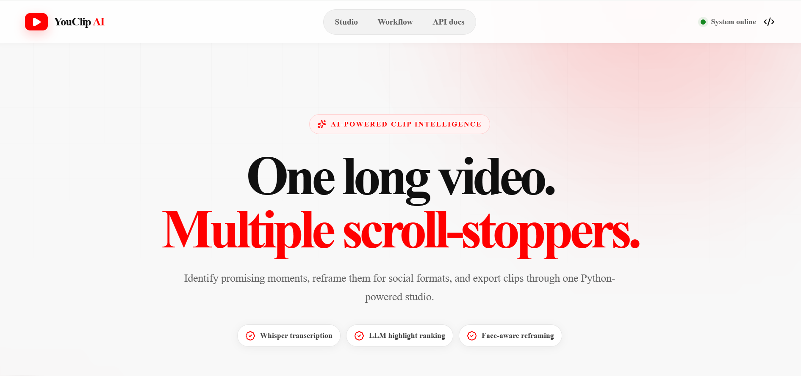

<div align="center">

# YouClip AI — AI Video Shorts Generator


</div>

---

YouClip AI is a local-first portfolio application that converts an authorized
YouTube video or uploaded media file into AI-selected short clips. A FastAPI
adapter provides bounded background jobs to a Next.js studio while the Python
pipeline handles transcription, LLM-assisted highlight selection, and media
cropping.

**Project integration, repairs, API, studio, tests, and documentation: Muhammad
Ali Nawaz 2026**

The media pipeline incorporates MIT-licensed code from
[SamurAIGPT's AI YouTube Shorts Generator](https://github.com/SamurAIGPT/AI-Youtube-Shorts-Generator).
Its license and provenance notices are preserved. The upstream license holder
is not presented as a co-owner of Muhammad Ali Nawaz's integration. See
[`docs/UPSTREAM_CHANGES.md`](docs/UPSTREAM_CHANGES.md).

## What it demonstrates

- Python, FastAPI, Pydantic, a thread-safe in-memory job store, and a bounded
  `ThreadPoolExecutor`
- Next.js 16, React 19, TypeScript, status polling, protected media loading,
  failure states, and responsive presentation
- Streamed uploads with byte, signature, ffprobe duration, and resolution
  limits
- Canonical YouTube-only URL handling that rejects lookalikes, user information,
  IP literals, custom ports, arbitrary hosts, and unsupported schemes
- Per-job input/output directories, unique local output names, safe media path
  checks, sanitized public errors, retention cleanup, and executor shutdown
- Long-video transcript chunks with relative timestamps, one absolute offset,
  strict LLM output validation, and deterministic overlap removal
- Mocked Python workflow/security tests, frontend HTTP-state tests, compilation,
  linting, type checking, production build checks, and CI

## Screenshots

| YouClip AI |
| --- |
|  |

## Tech Stack

### Frontend

- Next.js 16, React 19, TypeScript, native Fetch API
- Responsive custom CSS and XMLHttpRequest upload progress

### Backend and Media

- Python 3.11+, FastAPI, Uvicorn, Pydantic Settings
- yt-dlp, faster-whisper, OpenAI/Gemini clients, FFmpeg, FFprobe, OpenCV

### Quality Assurance

- pytest and pytest-asyncio
- ESLint, TypeScript checks, Next.js production build, and GitHub Actions CI

## Processing modes

| Mode | Processing path | Credentials |
|---|---|---|
| API | MuAPI download, transcription, LLM analysis, and autocrop | `MUAPI_API_KEY` |
| Local | uploaded file or yt-dlp, faster-whisper, OpenAI/Gemini, FFmpeg/OpenCV | `OPENAI_API_KEY` or `GEMINI_API_KEY` |

The displayed score is an LLM opinion used to rank candidates. It is not a
measured prediction of views, retention, engagement, or virality.

## Safety and scope

The default `WEB_ACCESS_MODE=local` accepts API requests only from a loopback
client, and the documented server command binds to `127.0.0.1`. If configured as
`hosted`, every API, job, upload, and media request requires an
`X-YouClip-Key`. The studio stores a supplied key only in the browser tab's
session storage and sends it as a request header.

The API:

- admits only `WEB_MAX_WORKERS + WEB_MAX_QUEUED_JOBS` active/queued jobs and
  returns `429` with retry guidance before a provider call when full;
- defaults to a 500 MB upload limit, four-hour duration limit, and 1920×1080
  resolution limit;
- never accepts arbitrary remote URLs—only supported HTTPS YouTube video URL
  shapes;
- removes full transcripts from public job results;
- keeps each job in a separate runtime directory and serves only result files
  explicitly referenced by that job;
- removes terminal job files and records after the configured retention period;
- maps provider and media-tool failures to stable messages while logging a job
  identifier server-side.

This remains a single-process portfolio application. Job state is not durable
across restart, running jobs are not cancellable, and it does not claim
distributed or unrestricted public-service scalability.

Only process media you own or have permission to transform. Real provider calls
may cost money. Review applicable platform terms and copyright requirements.

## Requirements

- Python 3.11 or newer
- Node.js 20.9 or newer and npm 10 or newer
- FFmpeg and FFprobe for uploaded/local media
- Local mode additionally needs the packages in `requirements-local.txt`
- A configured provider credential for real processing

## Backend setup

### Linux/macOS

```bash
python3 -m venv .venv
source .venv/bin/activate
python -m pip install --upgrade pip
python -m pip install -r requirements-dev.txt
cp .env.example .env
python -m uvicorn backend_api.app:app --host 127.0.0.1 --port 8000 --reload
```

### Windows PowerShell

```powershell
py -m venv .venv
.\.venv\Scripts\Activate.ps1
py -m pip install --upgrade pip
py -m pip install -r requirements-dev.txt
Copy-Item .env.example .env
py -m uvicorn backend_api.app:app --host 127.0.0.1 --port 8000 --reload
```

Install local media/AI dependencies when using local mode:

```bash
python -m pip install -r requirements-local.txt
```

## Configuration

Copy `.env.example` to `.env`. The relevant web defaults are:

```env
WEB_ACCESS_MODE=local
YOUCLIP_ACCESS_KEY=replace_with_a_long_random_value_for_hosted_mode
WEB_CORS_ORIGINS=http://localhost:3000,http://127.0.0.1:3000
WEB_MAX_WORKERS=1
WEB_MAX_QUEUED_JOBS=2
WEB_MAX_UPLOAD_MB=500
WEB_MAX_VIDEO_SECONDS=14400
WEB_MAX_VIDEO_WIDTH=1920
WEB_MAX_VIDEO_HEIGHT=1080
WEB_RETENTION_SECONDS=3600
```

Never commit `.env` or put `YOUCLIP_ACCESS_KEY` in a `NEXT_PUBLIC_*` variable.
For hosted use, generate a long random key, use HTTPS, restrict CORS, and place
the app behind a trusted reverse proxy.

## Frontend setup

In a second terminal:

```bash
cd frontend
cp .env.example .env.local
npm ci
npm run dev
```

On Windows PowerShell, use `Copy-Item .env.example .env.local`. Open
`http://localhost:3000`.

## API

| Method | Endpoint | Purpose |
|---|---|---|
| `GET` | `/api/health` | Limits and provider readiness |
| `POST` | `/api/uploads` | Validate and stage an uploaded local source |
| `POST` | `/api/jobs` | Admit a bounded generation job |
| `GET` | `/api/jobs/{job_id}` | Read an owned job until expiry |
| `GET` | `/api/media/{job_id}/{filename}` | Read a referenced, owned result |

There is intentionally no global job-list endpoint. In hosted mode add
`X-YouClip-Key` to each request.

Example:

```json
{
  "source_type": "url",
  "source": "https://www.youtube.com/watch?v=VIDEO_ID",
  "mode": "api",
  "num_clips": 3,
  "aspect_ratio": "9:16",
  "download_format": "720",
  "language": "en"
}
```

Job state is `queued → processing → completed | failed`. Terminal job records
include an `expires_at` timestamp.

## Verification

No live provider, public download, model download, or media render is required
by the automated checks.

```bash
python scripts/verify-backend-unchanged.py
python -m compileall -q main.py shorts_generator backend_api
python -m pytest -q
```

```bash
cd frontend
npm ci
npm run lint
npm test
npx tsc --noEmit
npm run build
```

The provenance command treats `docs/original-backend-sha256.txt` as a
historical upstream snapshot: declared repaired files must differ, while all
other covered upstream files must still match. See
[`docs/VALIDATION_REPORT.md`](docs/VALIDATION_REPORT.md) for the latest
packaged verification.

## Honest portfolio description

> Built and repaired a Python/FastAPI and Next.js video-shorts integration with
> streamed media validation, canonical YouTube URL policy, bounded in-process
> jobs, isolated outputs, strict long-video timestamp validation, protected
> result access, retention cleanup, mocked workflow tests, and CI.

Do not describe the score as measured virality, the application as a
production-scale public service, or incorporated MIT-licensed code as solely
authored by the portfolio owner.

## License

The required MIT notices for incorporated and project-owned work are preserved
in [`LICENSE`](LICENSE). External product and provider names belong to their
respective owners.
